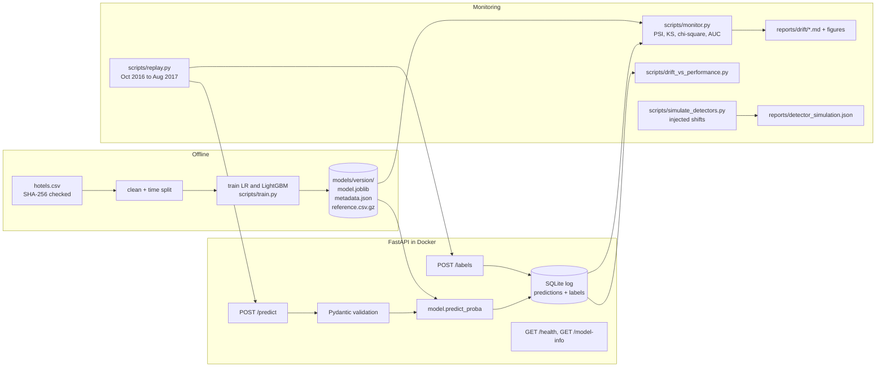
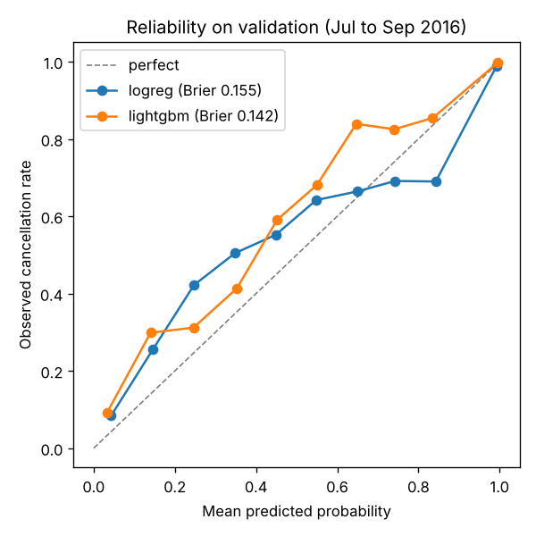
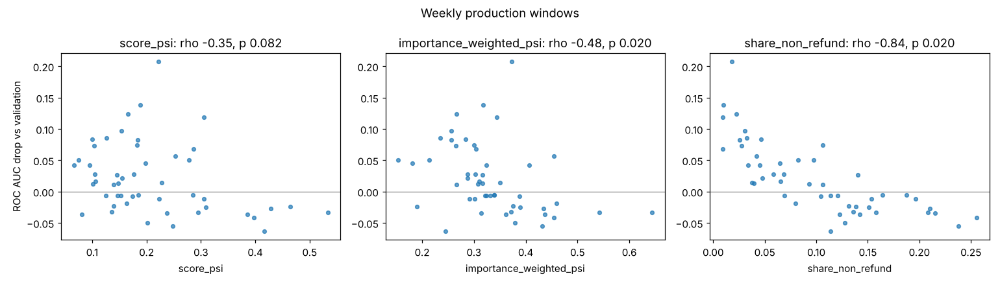
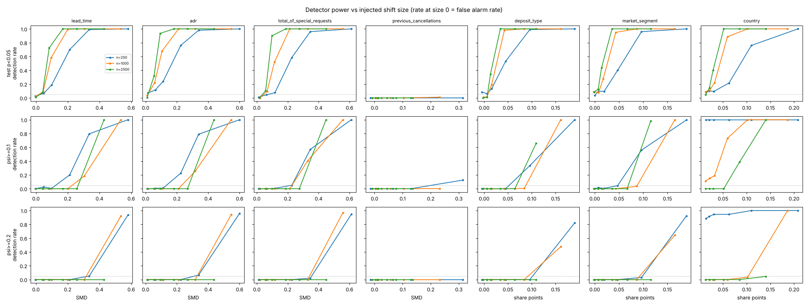

# Hotel booking cancellations: model, service, and drift monitoring

This project predicts whether a hotel booking will be canceled. It serves the model with FastAPI and monitors it for drift.
It replays 11 real later months through the service and checks drift and performance month by month.
It also tests the drift detectors themselves with injected shifts.

Everything runs locally or in GitHub Actions at no cost. Every result number in this README sits in a generated block. `scripts/render_readme.py` writes those blocks from the JSON files in `reports/`, and CI fails if they disagree.

## Headline findings

<!-- BEGIN:headline -->
* Served model: lightgbm, validation ROC AUC 0.878 (baseline logreg: 0.849).
* Production ROC AUC by arrival month ranges from 0.760 (2017-08) to 0.905 (2016-11). Validation: 0.878.
* Every production month has 15 to 19 of 22 features failing a KS or chi-square test, even with a Bonferroni correction. Significance alone says little at this sample size.
* Feature drift does not predict the AUC drop. Weekly Spearman correlation between importance-weighted PSI and AUC drop: -0.48 (p 0.02), the wrong sign for an alarm. The best alarm rule ("max feature PSI >= 0.2") has precision 0.29, against 0.29 for random alarms.
* The share of Non Refund bookings tracks the drop much better: weekly Spearman -0.84 (p 0.02). Fewer easy cases means lower AUC.
* Detector check, n = 1000 rows: a lead_time shift of SMD 0.10 is caught by KS in 58% of trials and by PSI >= 0.1 in 0%. With no shift, at least one of 22 features fails p < 0.05 in 50% of trials (6% with Bonferroni).
* Single prediction latency in Docker: p50 16.5 ms, p95 23.5 ms (Intel(R) Xeon(R) Processor @ 2.10GHz, 4 vCPUs).
<!-- END:headline -->

## Problem

A hotel wants a cancellation probability for each booking, so it can plan overbooking and staffing.
The label is `is_canceled` (1 if the booking was canceled).
The model scores a booking at booking time. The true label is known by the arrival date.

## Dataset

**Hotel Booking Demand** (Antonio, Almeida and Nunes, 2019, *Data in Brief* 22:41 to 49, [paper](https://doi.org/10.1016/j.dib.2018.11.126)). License: CC BY 4.0.
It has bookings for two hotels in Portugal (a city hotel and a resort hotel) with arrival dates from July 2015 to August 2017.

* Download URL: `https://raw.githubusercontent.com/rfordatascience/tidytuesday/master/data/2020/2020-02-11/hotels.csv` (the TidyTuesday mirror of the paper's data).
* SHA-256: `7c2ae42a7353905ea136e5c2287f17c92c5435826598bfbb8491c6f0c7b1fc06`. `hotelmon.data.download()` checks it and stops on a mismatch.
* Raw data is not committed. It downloads to `data/`, which git ignores.

**Why this dataset.**

* It has a real time order: every booking has an arrival date. Later months are real later data, so drift is measured on what really happened, not only on synthetic shifts.
* It is tabular, binary, and mixes numeric and categorical features. That lets the project use PSI and KS on numeric features and chi-square on categorical ones.
* It is large enough for monthly and weekly windows (see the bookings per month in the monitoring table).
* It is public with a clear license, and the GitHub mirror downloads without keys.

I checked which sources this environment can reach. Kaggle, the UCI repository, OpenML, and census.gov were all blocked. GitHub raw files were reachable.

**Leakage removed.** These columns are recorded after the booking is made, so they are never used:
`reservation_status` and `reservation_status_date` (the outcome itself), `assigned_room_type` (set at check-in),
`booking_changes` (counted until check-in or cancellation), and `required_car_parking_spaces` (no canceled booking in the data has a parking space, so it is only filled in for guests who arrive).

**Cleaning.** Rows that the API would reject are dropped: no guests, a negative rate, or a rate above 1000 EUR.
Missing `children` is set to 0. `NULL` in `agent`, `company`, and `country` is kept as its own category.

**Time split by arrival date.**

<!-- BEGIN:data -->
| Split | Arrival dates | Bookings |
|---|---|---|
| Train | 2015-07-01 to 2016-06-30 | 49107 |
| Validation | 2016-07-01 to 2016-09-30 | 15006 |
| Production (replayed) | 2016-10-01 to 2017-08-31 | 55095 |

Rows after cleaning: 119208. Source: `scripts/train.py`, file `reports/training_metrics.json`.
<!-- END:data -->

The training period covers one full year, so every calendar month appears once in training.

## Design



* The model artifact holds the fitted pipeline, the metadata, and a reference sample. The metadata records training dates, features, metrics, the data checksum, and the git commit. The reference sample is the validation period with model scores and labels.
* The service logs every prediction to SQLite with a UTC timestamp, the model version, the full input, and the output. Labels arrive later through `POST /labels` and join on the prediction id.
* Monitoring reads only the log and the reference. It does not need the training data.

## Training results

Both models are trained on the training year and scored on the validation quarter.
The served model is the one with the higher validation ROC AUC.

<!-- BEGIN:training -->
| Model | ROC AUC (95% bootstrap CI) | PR AUC | Brier | ECE (10 bins) |
|---|---|---|---|---|
| logreg | 0.849 (0.843 to 0.855) | 0.782 | 0.155 | 0.079 |
| lightgbm (served) | 0.878 (0.873 to 0.884) | 0.828 | 0.142 | 0.089 |

Validation cancellation rate: 0.356 (the PR AUC of a random model). Source: `scripts/train.py`, file `reports/training_metrics.json`.
<!-- END:training -->



Neither model is well calibrated on the validation quarter. LightGBM's predictions sit below the observed cancellation rate in most bins, so it under-predicts overall. Logistic regression under-predicts at low scores and over-predicts in its upper bins. I did not recalibrate. Recalibrating on the validation period would leave no clean held-out period.

**How the LightGBM settings were chosen.** With LightGBM's default native categorical splits, the model was worse than logistic regression. It overfit high-cardinality fields like `agent` and `country`. I compared a small grid on an inner time split *inside the training year*. The validation period was not used for this choice.

<!-- BEGIN:tuning -->
| max_cat_to_onehot | n_estimators | num_leaves | ROC AUC | Brier |
|---|---|---|---|---|
| 4 | 200 | 15 | 0.901 | 0.147 |
| 4 | 200 | 31 | 0.891 | 0.154 |
| 4 | 400 | 15 | 0.897 | 0.152 |
| 4 | 400 | 31 | 0.892 | 0.158 |
| 64 | 200 | 15 | 0.917 | 0.117 |
| 64 | 200 | 31 | 0.914 | 0.119 |
| 64 | 400 | 15 | 0.914 | 0.118 |
| 64 | 400 | 31 | 0.912 | 0.122 |

Fit on 32917 bookings (Jul 2015 to Mar 2016), scored on 16190 (Apr to Jun 2016). Source: `scripts/tune_lightgbm.py`.
<!-- END:tuning -->

## Serving

```bash
make docker-build && make docker-run       # serves on http://localhost:8000
curl localhost:8000/health
curl localhost:8000/model-info
curl -X POST localhost:8000/predict -H 'content-type: application/json' -d '{
  "hotel": "City Hotel", "arrival_date": "2017-03-14", "lead_time": 45,
  "stays_in_weekend_nights": 1, "stays_in_week_nights": 2, "adults": 2,
  "meal": "BB", "country": "PRT", "market_segment": "Online TA",
  "distribution_channel": "TA/TO", "reserved_room_type": "A",
  "deposit_type": "No Deposit", "agent": "9", "customer_type": "Transient", "adr": 95.0}'
```

* `POST /predict` takes one booking object, or `{"instances": [...]}` with 1 to 1000 bookings.
* `POST /labels` takes `{"labels": [{"prediction_id": 1, "label": 0}]}`.
* Bad input returns HTTP 422 with the field path, for example `["body", "batch", "instances", 1, "lead_time"]`, and a message like `Input should be greater than or equal to 0`. Unknown fields, missing fields, out-of-range numbers, unknown category values, and bookings with no guests are rejected.
* Unseen `country`, `agent`, or `company` codes are accepted if well formed. The model maps them to an "infrequent" bucket.

**Latency (single predictions).**

<!-- BEGIN:latency -->
| Setup | Requests | p50 ms | p95 ms | p99 ms | Sequential req/s |
|---|---|---|---|---|---|
| docker (local build) | 2000 | 16.5 | 23.5 | 27.2 | 57 |

Machine: Intel(R) Xeon(R) Processor @ 2.10GHz, 4 logical CPUs, 15.7 GB RAM, Linux 6.18.44-fc-v114. One client, one request at a time, after 100 warm-up requests. Time is measured at the client and includes HTTP, validation, inference, and the SQLite write. Source: `scripts/load_test.py`, file `reports/latency.json`.
<!-- END:latency -->

Note on the image used for this measurement: the sandbox that ran it blocks Debian's package mirrors. So for this local build only, `libgomp1` came from the copy bundled in the scikit-learn wheel instead of `apt-get`. Everything else matched the committed `Dockerfile`. CI builds the committed `Dockerfile` unchanged.

## Monitoring on real later data

`scripts/replay.py` sends every booking from October 2016 to August 2017 to `POST /predict`, in arrival order, in batches of 500. It then sends the true outcomes to `POST /labels`.
`scripts/monitor.py` reads the SQLite log and compares each arrival month with the reference (the validation quarter).

* Numeric features: PSI with 10 bins at reference deciles, plus a two-sample KS test.
* Categorical features: PSI over categories, plus a chi-square test of homogeneity.
* Prediction drift: PSI and KS on the score distribution.
* Test flags use alpha 0.05 with a Bonferroni correction over the 22 monitored features.
* `arrival_month` is not monitored. The reference covers July to September only, so every later month would "drift" by construction.

<!-- BEGIN:monitoring -->
| Arrival month | Bookings | Cancel rate | ROC AUC (95% CI) | Brier | Score PSI | Features PSI >= 0.1 | Features failing test |
|---|---|---|---|---|---|---|---|
| validation (ref) | 15006 | 0.356 | 0.878 | 0.142 |  |  |  |
| [2016-10](reports/drift/2016-10.md) | 6196 | 0.406 | 0.899 (0.891 to 0.906) | 0.186 | 0.350 | 4 / 22 | 16 / 22 |
| [2016-11](reports/drift/2016-11.md) | 4434 | 0.369 | 0.905 (0.897 to 0.914) | 0.135 | 0.121 | 8 / 22 | 15 / 22 |
| [2016-12](reports/drift/2016-12.md) | 3846 | 0.363 | 0.854 (0.842 to 0.866) | 0.174 | 0.035 | 4 / 22 | 17 / 22 |
| [2017-01](reports/drift/2017-01.md) | 3673 | 0.340 | 0.887 (0.876 to 0.898) | 0.132 | 0.152 | 10 / 22 | 19 / 22 |
| [2017-02](reports/drift/2017-02.md) | 4168 | 0.326 | 0.860 (0.850 to 0.871) | 0.148 | 0.133 | 8 / 22 | 17 / 22 |
| [2017-03](reports/drift/2017-03.md) | 4948 | 0.338 | 0.899 (0.890 to 0.908) | 0.124 | 0.125 | 8 / 22 | 17 / 22 |
| [2017-04](reports/drift/2017-04.md) | 5653 | 0.435 | 0.883 (0.876 to 0.891) | 0.154 | 0.189 | 4 / 22 | 15 / 22 |
| [2017-05](reports/drift/2017-05.md) | 6305 | 0.438 | 0.882 (0.874 to 0.891) | 0.158 | 0.164 | 4 / 22 | 17 / 22 |
| [2017-06](reports/drift/2017-06.md) | 5639 | 0.432 | 0.862 (0.852 to 0.871) | 0.165 | 0.201 | 4 / 22 | 15 / 22 |
| [2017-07](reports/drift/2017-07.md) | 5310 | 0.374 | 0.782 (0.772 to 0.795) | 0.214 | 0.111 | 3 / 22 | 16 / 22 |
| [2017-08](reports/drift/2017-08.md) | 4923 | 0.368 | 0.760 (0.747 to 0.772) | 0.226 | 0.210 | 5 / 22 | 17 / 22 |

Source: `scripts/replay.py` then `scripts/monitor.py`, file `reports/monitoring_summary.json`.
<!-- END:monitoring -->


Per-month reports with full feature tables and figures are in [`reports/drift/`](reports/drift/README.md).

**What the monthly view shows.**

* The statistical tests flag most features in every month. With thousands of rows per month, KS and chi-square detect differences far too small to matter.
* `agent` and `adr` (the daily rate) have the largest PSI. Travel agent IDs change over time. Prices follow the season.
* ROC AUC holds near the validation level until June 2017, then drops in July and August 2017. Feature drift in those two months is not higher than in the good months.
* The mean score is below the true cancellation rate in every month. The Brier score moves with that calibration gap even when AUC holds.

## Does feature drift predict performance drop?

`scripts/drift_vs_performance.py` asks this directly. For each production window (calendar months and ISO weeks), it computes drift summaries and the drop in ROC AUC against validation.
Weekly windows are autocorrelated. So the weekly p-values come from a circular-shift permutation test, which keeps that structure. With W weeks, the smallest possible p-value is 1/W.

<!-- BEGIN:drift_perf -->
Spearman correlation between each signal and the ROC AUC drop (validation AUC minus window AUC). Positive means more drift goes with a bigger drop.

| Signal | Monthly, n=11 | Weekly, n=49 |
|---|---|---|
| Score PSI | -0.04 (p 0.92) | -0.35 (p 0.08) |
| Score KS statistic | -0.07 (p 0.85) | -0.29 (p 0.20) |
| Mean feature PSI | -0.34 (p 0.31) | -0.47 (p 0.02) |
| Max feature PSI | -0.17 (p 0.62) | -0.45 (p 0.02) |
| Number of features with PSI >= 0.1 | -0.44 (p 0.17) | -0.44 (p 0.04) |
| Importance-weighted feature PSI | -0.08 (p 0.81) | -0.48 (p 0.02) |
| Share of Non Refund bookings (not a drift metric) | -0.65 (p 0.04) | -0.84 (p 0.02) |

Degraded week: window ROC AUC more than 0.05 below validation. 14 of 49 weeks are degraded, so a rule that fires at random has precision about 0.29.

| Alarm rule (weekly) | Alarms | On degraded weeks | Precision | Recall |
|---|---|---|---|---|
| score PSI >= 0.1 | 44 | 12 | 0.27 | 0.86 |
| score PSI >= 0.2 | 20 | 5 | 0.25 | 0.36 |
| max feature PSI >= 0.2 | 49 | 14 | 0.29 | 1.00 |
| >= 5 features with PSI >= 0.1 | 45 | 12 | 0.27 | 0.86 |
| importance-weighted PSI >= 0.1 | 49 | 14 | 0.29 | 1.00 |

ROC AUC on No Deposit bookings only:

| Window | ROC AUC, No Deposit only |
|---|---|
| validation | 0.840 |
| 2016-10 | 0.854 |
| 2016-11 | 0.839 |
| 2016-12 | 0.826 |
| 2017-01 | 0.833 |
| 2017-02 | 0.815 |
| 2017-03 | 0.849 |
| 2017-04 | 0.827 |
| 2017-05 | 0.819 |
| 2017-06 | 0.791 |
| 2017-07 | 0.762 |
| 2017-08 | 0.751 |

Source: `scripts/drift_vs_performance.py`, file `reports/drift_vs_performance.json`.
<!-- END:drift_perf -->



**Answer: not on this dataset. The sign is often the opposite.**

* No drift summary has a positive correlation with the AUC drop. At the weekly level, more feature drift goes with a *smaller* drop.
* Every alarm rule has precision close to the share of degraded weeks. That is what random alarms would get.
* The best single explanation is the share of `Non Refund` deposits. These bookings are almost always canceled, so they are easy to rank. When their share falls, as in July and August 2017, AUC falls. This is a change in the mix of easy and hard cases. Generic drift scores do not capture it.
* AUC on No Deposit bookings alone also falls through spring 2017 and is lowest in July and August 2017. So the mix effect is not the whole story. Part of the drop is harder cases within the same segment.

The practical lesson: on this data, drift scores are useful to explain a change after the fact. They are not useful as an alarm for performance loss. Watching performance directly on labeled data, and slicing it by key segments, works better.

## Validating the detectors

`scripts/simulate_detectors.py` tests the detectors on data with a known answer.
The validation quarter is split at random into a reference half and a pool half.
Each trial draws n rows from the pool. It draws either plainly (no shift) or with importance weights that create a shift of known size.
Shifts are made by resampling real rows, so every value stays realistic.

* Numeric shift: weights proportional to exp(beta times z), where z is the clipped standard score. The size is reported as the standardized mean difference (SMD) it produces.
* Categorical shift: the share of one category rises by a set number of points.
* Rows are drawn without replacement. With no shift, the sample and the reference are then exchangeable subsets of the same period, so each test's null holds exactly. (A first version drew with replacement. That inflated chi-square false alarms at large n, because the pool's own sampling noise adds to the test's.)
* The effect column is the shift measured in the drawn samples. At n = 2500 the sample uses a third of the pool, so the achieved shift is smaller than at n = 250 for the same weights.

<!-- BEGIN:simulation -->
**False alarm rate with no shift (single feature).**

| Feature | n | KS or chi2 p<0.05 | PSI>=0.1 | PSI>=0.2 |
|---|---|---|---|---|
| lead_time | 250 | 2% | 0% | 0% |
| lead_time | 1000 | 2% | 0% | 0% |
| lead_time | 2500 | 1% | 0% | 0% |
| adr | 250 | 7% | 0% | 0% |
| adr | 1000 | 4% | 0% | 0% |
| adr | 2500 | 0% | 0% | 0% |
| total_of_special_requests | 250 | 1% | 0% | 0% |
| total_of_special_requests | 1000 | 0% | 0% | 0% |
| total_of_special_requests | 2500 | 0% | 0% | 0% |
| previous_cancellations | 250 | 0% | 0% | 0% |
| previous_cancellations | 1000 | 0% | 0% | 0% |
| previous_cancellations | 2500 | 0% | 0% | 0% |
| deposit_type | 250 | 8% | 0% | 0% |
| deposit_type | 1000 | 1% | 0% | 0% |
| deposit_type | 2500 | 0% | 0% | 0% |
| market_segment | 250 | 4% | 0% | 0% |
| market_segment | 1000 | 9% | 0% | 0% |
| market_segment | 2500 | 8% | 0% | 0% |
| country | 250 | 8% | 100% | 88% |
| country | 1000 | 9% | 11% | 0% |
| country | 2500 | 4% | 0% | 0% |


**Detection rate by shift size, n = 1000.**

| Feature | Injected shift | KS or chi2 p<0.05 | PSI>=0.1 | PSI>=0.2 |
|---|---|---|---|---|
| lead_time | SMD 0.05 | 9% | 0% | 0% |
| lead_time | SMD 0.10 | 58% | 0% | 0% |
| lead_time | SMD 0.20 | 100% | 0% | 0% |
| lead_time | SMD 0.30 | 100% | 18% | 0% |
| lead_time | SMD 0.53 | 100% | 100% | 92% |
| adr | SMD 0.06 | 22% | 0% | 0% |
| adr | SMD 0.11 | 68% | 0% | 0% |
| adr | SMD 0.21 | 100% | 0% | 0% |
| adr | SMD 0.32 | 100% | 26% | 0% |
| adr | SMD 0.55 | 100% | 100% | 94% |
| total_of_special_requests | SMD 0.07 | 10% | 0% | 0% |
| total_of_special_requests | SMD 0.11 | 52% | 0% | 0% |
| total_of_special_requests | SMD 0.21 | 100% | 0% | 0% |
| total_of_special_requests | SMD 0.33 | 100% | 40% | 0% |
| total_of_special_requests | SMD 0.56 | 100% | 100% | 97% |
| previous_cancellations | SMD 0.01 | 0% | 0% | 0% |
| previous_cancellations | SMD 0.02 | 0% | 0% | 0% |
| previous_cancellations | SMD 0.06 | 0% | 0% | 0% |
| previous_cancellations | SMD 0.10 | 0% | 0% | 0% |
| previous_cancellations | SMD 0.23 | 1% | 0% | 0% |
| deposit_type | +0.01 share (Non Refund) | 2% | 0% | 0% |
| deposit_type | +0.02 share (Non Refund) | 19% | 0% | 0% |
| deposit_type | +0.04 share (Non Refund) | 98% | 0% | 0% |
| deposit_type | +0.08 share (Non Refund) | 100% | 0% | 0% |
| deposit_type | +0.16 share (Non Refund) | 100% | 100% | 48% |
| market_segment | +0.01 share (Groups) | 8% | 0% | 0% |
| market_segment | +0.02 share (Groups) | 28% | 0% | 0% |
| market_segment | +0.04 share (Groups) | 95% | 0% | 0% |
| market_segment | +0.09 share (Groups) | 100% | 4% | 0% |
| market_segment | +0.17 share (Groups) | 100% | 100% | 64% |
| country | +0.02 share (GBR) | 11% | 15% | 0% |
| country | +0.03 share (GBR) | 22% | 19% | 0% |
| country | +0.06 share (GBR) | 88% | 73% | 0% |
| country | +0.10 share (GBR) | 100% | 100% | 4% |
| country | +0.19 share (GBR) | 100% | 100% | 100% |


**Any of the 22 monitored features fires, no shift.**

| n | p<0.05 | p<0.05/k (Bonferroni) | PSI>=0.1 | PSI>=0.2 |
|---|---|---|---|---|
| 250 | 57% | 12% | 100% | 100% |
| 1000 | 50% | 6% | 92% | 0% |
| 2500 | 63% | 8% | 0% | 0% |


**Natural week-to-week variation inside the validation period** (each week against the rest of the period, no injected shift).

| Week | Bookings | Features PSI>=0.1 | Features failing test (Bonferroni) | Max PSI |
|---|---|---|---|---|
| 2016-06-27/2016-07-03 | 424 | 7 | 9 | 0.90 (agent) |
| 2016-07-04/2016-07-10 | 995 | 6 | 10 | 0.67 (agent) |
| 2016-07-11/2016-07-17 | 1021 | 4 | 9 | 0.43 (agent) |
| 2016-07-18/2016-07-24 | 1108 | 3 | 6 | 0.44 (agent) |
| 2016-07-25/2016-07-31 | 1012 | 4 | 7 | 0.47 (agent) |
| 2016-08-01/2016-08-07 | 1120 | 5 | 13 | 0.52 (agent) |
| 2016-08-08/2016-08-14 | 1186 | 5 | 9 | 0.47 (agent) |
| 2016-08-15/2016-08-21 | 1229 | 5 | 10 | 0.48 (agent) |
| 2016-08-22/2016-08-28 | 1097 | 2 | 12 | 0.69 (agent) |
| 2016-08-29/2016-09-04 | 1100 | 4 | 8 | 0.67 (agent) |
| 2016-09-05/2016-09-11 | 1137 | 5 | 10 | 0.81 (agent) |
| 2016-09-12/2016-09-18 | 1291 | 9 | 14 | 0.89 (agent) |
| 2016-09-19/2016-09-25 | 1256 | 7 | 16 | 0.84 (agent) |
| 2016-09-26/2016-10-02 | 1030 | 13 | 18 | 1.50 (agent) |


200 trials per cell, seed 42. Source: `scripts/simulate_detectors.py`, file `reports/detector_simulation.json`.
<!-- END:simulation -->



**Where the detectors fail.**

* **Many features means many false alarms.** Each single test stays near or below 5% with no shift. But across 22 features, at least one fires in about half the trials or more. A Bonferroni correction brings this down a lot, though not exactly to 5%.
* **PSI is biased upward at small n.** Sampling noise alone adds to PSI. At the smallest n, `country` (many rare categories) crosses PSI 0.2 in most no-shift trials. The same real shift crosses PSI 0.1 more often at n = 250 than at n = 2500. So a fixed PSI threshold partly measures traffic volume.
* **PSI 0.1 is a coarse threshold.** Mean shifts that KS catches almost always at n = 1000 rarely reach PSI 0.1 at that size.
* **Discrete, zero-heavy features.** `previous_cancellations` is almost always 0, so the decile bins collapse and the KS test has many ties. Neither detector fires until the tilt is large. KS on tied data is conservative: its no-shift false alarm rate on `total_of_special_requests` is close to 0.
* **Real data is never perfectly stable.** Each week inside the validation quarter, compared with the rest of that quarter, already fails the test on several features. A detector tuned on a random-split null will fire on real but harmless variation.
* **Concept drift is invisible to these detectors by design.** If the link between features and outcome changes but the features do not, feature drift stays flat. Only labeled performance shows it.

## Limitations

* Two hotels in one country over two years. The findings about drift and performance are specific to this data.
* The event time is the arrival date. A real system would score at booking time, so the "production" months also contain bookings made many months earlier.
* The replay sends labels right after predictions. In reality a label arrives only on the arrival date or the cancellation date.
* `adr` and `total_of_special_requests` may be updated after booking in the hotel system. The dataset does not say when. I kept them, but they could leak a little.
* The served model is not recalibrated, and the decision threshold is a fixed 0.5. Cost-based thresholds are out of scope.
* Weekly windows are small, so weekly ROC AUC is noisy and small weekly drops are not meaningful.
* Latency was measured on one shared cloud VM, with one client sending requests in sequence. It is not a capacity test.
* Nothing is deployed. The Docker image is built and run in CI only.

## Reproduce

Requires Python 3.12 and, for the service, Docker.

```bash
python -m venv .venv && source .venv/bin/activate
make setup         # pip install -r requirements.txt -e .
make results       # download, tune, train, replay, monitor, drift-perf, simulate, readme
make test lint     # pytest and ruff
make docker-build && make docker-run   # in another terminal:
make latency && make readme
```

| Output | Script |
|---|---|
| `reports/tuning_lightgbm.json` | `scripts/tune_lightgbm.py` |
| `reports/training_metrics.json`, `reports/figures/reliability_valid.png`, `models/<version>/` | `scripts/train.py` |
| `data/replay.db` (prediction log) | `scripts/replay.py` |
| `reports/monitoring_summary.json`, `reports/drift/` | `scripts/monitor.py` |
| `reports/drift_vs_performance.json`, `reports/figures/drift_vs_auc_drop.png` | `scripts/drift_vs_performance.py` |
| `reports/detector_simulation.json`, `reports/figures/detector_power.png` | `scripts/simulate_detectors.py` |
| `reports/latency.json` | `scripts/load_test.py` |
| Result blocks in this README | `scripts/render_readme.py` |

All randomness is seeded. LightGBM runs with `deterministic=True` and one thread. Small floating point differences across CPUs and library builds are still possible.

## Repository layout

```
src/hotelmon/   config, schema (Pydantic), data, features, evaluation, artifacts,
                api (FastAPI), logdb (SQLite), drift, monitoring, simulation
scripts/        the pipeline steps listed above
tests/          pytest: data, features, API, logging, drift metrics, monitoring
reports/        generated results (JSON, Markdown, figures)
```
