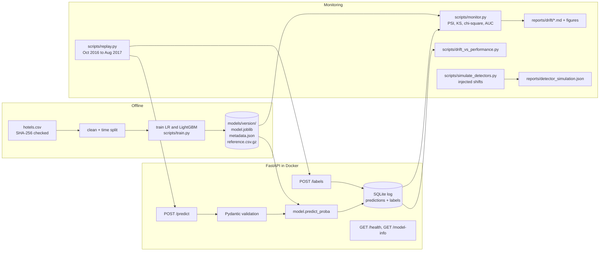

# Hotel booking cancellations: model, service, and drift monitoring

This project predicts whether a hotel booking will be canceled. It serves the model with FastAPI and monitors it for drift.
It replays 11 real later months through the service and checks drift and performance month by month.
It also tests the drift detectors themselves with injected shifts.

Everything runs locally or in GitHub Actions at no cost. Every result number in this README sits in a generated block. `scripts/render_readme.py` writes those blocks from the JSON files in `reports/`, and CI fails if they disagree.

## Headline findings

<!-- BEGIN:headline -->
<!-- END:headline -->

## Problem

A hotel wants a cancellation probability for each booking, so it can plan overbooking and staffing.
The label is `is_canceled` (1 if the booking was canceled).
The model scores a booking at booking time. The true label is known by the arrival date.

## Dataset

**Hotel Booking Demand** (Antonio, Almeida and Nunes, 2019, *Data in Brief* 22:41 to 49, [paper](https://doi.org/10.1016/j.dib.2018.11.126)). License: CC BY 4.0.
It has bookings for two hotels in Portugal (a city hotel and a resort hotel) with arrival dates from July 2015 to August 2017.

* Download URL: `https://raw.githubusercontent.com/rfordatascience/tidytuesday/master/data/2020/2020-02-11/hotels.csv` (the TidyTuesday mirror of the paper's data).
* SHA-256: `7c2ae42a7353905ea136e5c2287f17c92c5435826598bfbb8491c6f0c7b1fc06`. `hotelmon.data.download()` checks it and stops on a mismatch.
* Raw data is not committed. It downloads to `data/`, which git ignores.

**Why this dataset.**

* It has a real time order: every booking has an arrival date. Later months are real later data, so drift is measured on what really happened, not only on synthetic shifts.
* It is tabular, binary, and mixes numeric and categorical features. That lets the project use PSI and KS on numeric features and chi-square on categorical ones.
* It is large enough for monthly and weekly windows (see the bookings per month in the monitoring table).
* It is public with a clear license, and the GitHub mirror downloads without keys.

I checked which sources this environment can reach. Kaggle, the UCI repository, OpenML, and census.gov were all blocked. GitHub raw files were reachable.

**Leakage removed.** These columns are recorded after the booking is made, so they are never used:
`reservation_status` and `reservation_status_date` (the outcome itself), `assigned_room_type` (set at check-in),
`booking_changes` (counted until check-in or cancellation), and `required_car_parking_spaces` (no canceled booking in the data has a parking space, so it is only filled in for guests who arrive).

**Cleaning.** Rows that the API would reject are dropped: no guests, a negative rate, or a rate above 1000 EUR.
Missing `children` is set to 0. `NULL` in `agent`, `company`, and `country` is kept as its own category.

**Time split by arrival date.**

<!-- BEGIN:data -->
<!-- END:data -->

The training period covers one full year, so every calendar month appears once in training.

## Design



* The model artifact holds the fitted pipeline, the metadata, and a reference sample. The metadata records training dates, features, metrics, the data checksum, and the git commit. The reference sample is the validation period with model scores and labels.
* The service logs every prediction to SQLite with a UTC timestamp, the model version, the full input, and the output. Labels arrive later through `POST /labels` and join on the prediction id.
* Monitoring reads only the log and the reference. It does not need the training data.

## Training results

Both models are trained on the training year and scored on the validation quarter.
The served model is the one with the higher validation ROC AUC.

<!-- BEGIN:training -->
<!-- END:training -->


Neither model is well calibrated on the validation quarter. LightGBM's predictions sit below the observed cancellation rate in most bins, so it under-predicts overall. Logistic regression under-predicts at low scores and over-predicts in its upper bins. I did not recalibrate. Recalibrating on the validation period would leave no clean held-out period.

**How the LightGBM settings were chosen.** With LightGBM's default native categorical splits, the model was worse than logistic regression. It overfit high-cardinality fields like `agent` and `country`. I compared a small grid on an inner time split *inside the training year*. The validation period was not used for this choice.

<!-- BEGIN:tuning -->
<!-- END:tuning -->

## Serving

```bash
make docker-build && make docker-run       # serves on http://localhost:8000
curl localhost:8000/health
curl localhost:8000/model-info
curl -X POST localhost:8000/predict -H 'content-type: application/json' -d '{
  "hotel": "City Hotel", "arrival_date": "2017-03-14", "lead_time": 45,
  "stays_in_weekend_nights": 1, "stays_in_week_nights": 2, "adults": 2,
  "meal": "BB", "country": "PRT", "market_segment": "Online TA",
  "distribution_channel": "TA/TO", "reserved_room_type": "A",
  "deposit_type": "No Deposit", "agent": "9", "customer_type": "Transient", "adr": 95.0}'
```

* `POST /predict` takes one booking object, or `{"instances": [...]}` with 1 to 1000 bookings.
* `POST /labels` takes `{"labels": [{"prediction_id": 1, "label": 0}]}`.
* Bad input returns HTTP 422 with the field path, for example `["body", "batch", "instances", 1, "lead_time"]`, and a message like `Input should be greater than or equal to 0`. Unknown fields, missing fields, out-of-range numbers, unknown category values, and bookings with no guests are rejected.
* Unseen `country`, `agent`, or `company` codes are accepted if well formed. The model maps them to an "infrequent" bucket.

**Latency (single predictions).**

<!-- BEGIN:latency -->
<!-- END:latency -->

Note on the image used for this measurement: the sandbox that ran it blocks Debian's package mirrors. So for this local build only, `libgomp1` came from the copy bundled in the scikit-learn wheel instead of `apt-get`. Everything else matched the committed `Dockerfile`. CI builds the committed `Dockerfile` unchanged.

## Monitoring on real later data

`scripts/replay.py` sends every booking from October 2016 to August 2017 to `POST /predict`, in arrival order, in batches of 500. It then sends the true outcomes to `POST /labels`.
`scripts/monitor.py` reads the SQLite log and compares each arrival month with the reference (the validation quarter).

* Numeric features: PSI with 10 bins at reference deciles, plus a two-sample KS test.
* Categorical features: PSI over categories, plus a chi-square test of homogeneity.
* Prediction drift: PSI and KS on the score distribution.
* Test flags use alpha 0.05 with a Bonferroni correction over the 22 monitored features.
* `arrival_month` is not monitored. The reference covers July to September only, so every later month would "drift" by construction.

<!-- BEGIN:monitoring -->
<!-- END:monitoring -->


Per-month reports with full feature tables and figures are in [`reports/drift/`](reports/drift/README.md).

**What the monthly view shows.**

* The statistical tests flag most features in every month. With thousands of rows per month, KS and chi-square detect differences far too small to matter.
* `agent` and `adr` (the daily rate) have the largest PSI. Travel agent IDs change over time. Prices follow the season.
* ROC AUC holds near the validation level until June 2017, then drops in July and August 2017. Feature drift in those two months is not higher than in the good months.
* The mean score is below the true cancellation rate in every month. The Brier score moves with that calibration gap even when AUC holds.

## Does feature drift predict performance drop?

`scripts/drift_vs_performance.py` asks this directly. For each production window (calendar months and ISO weeks), it computes drift summaries and the drop in ROC AUC against validation.
Weekly windows are autocorrelated. So the weekly p-values come from a circular-shift permutation test, which keeps that structure. With W weeks, the smallest possible p-value is 1/W.

<!-- BEGIN:drift_perf -->
<!-- END:drift_perf -->


**Answer: not on this dataset. The sign is often the opposite.**

* No drift summary has a positive correlation with the AUC drop. At the weekly level, more feature drift goes with a *smaller* drop.
* Every alarm rule has precision close to the share of degraded weeks. That is what random alarms would get.
* The best single explanation is the share of `Non Refund` deposits. These bookings are almost always canceled, so they are easy to rank. When their share falls, as in July and August 2017, AUC falls. This is a change in the mix of easy and hard cases. Generic drift scores do not capture it.
* AUC on No Deposit bookings alone also falls through spring 2017 and is lowest in July and August 2017. So the mix effect is not the whole story. Part of the drop is harder cases within the same segment.

The practical lesson: on this data, drift scores are useful to explain a change after the fact. They are not useful as an alarm for performance loss. Watching performance directly on labeled data, and slicing it by key segments, works better.

## Validating the detectors

`scripts/simulate_detectors.py` tests the detectors on data with a known answer.
The validation quarter is split at random into a reference half and a pool half.
Each trial draws n rows from the pool. It draws either plainly (no shift) or with importance weights that create a shift of known size.
Shifts are made by resampling real rows, so every value stays realistic.

* Numeric shift: weights proportional to exp(beta times z), where z is the clipped standard score. The size is reported as the standardized mean difference (SMD) it produces.
* Categorical shift: the share of one category rises by a set number of points.

<!-- BEGIN:simulation -->
<!-- END:simulation -->


**Where the detectors fail.**

* **Many features means many false alarms.** Each test is calibrated near 5% on its own. But with 22 features, at least one fires most of the time when nothing changed. A Bonferroni correction fixes this for the tests.
* **PSI false alarms depend on sample size.** At small n, sampling noise alone pushes PSI over 0.1 for features with many categories, such as `country`. A fixed PSI threshold means different things at different traffic levels.
* **PSI misses small shifts at any n.** A 0.1 standard deviation shift rarely crosses PSI 0.1, even with thousands of rows. KS catches it at large n.
* **Discrete, zero-heavy features.** `previous_cancellations` is almost always 0, so the decile bins collapse to two bins. Shifts in the non-zero tail are hard to see, and KS on tied data is conservative.
* **Real data is never perfectly stable.** Week-to-week variation inside the validation quarter already flags several features. A detector tuned on the random-split null will fire on real but harmless variation.
* **Concept drift is invisible to these detectors by design.** If the link between features and outcome changes but the features do not, feature drift stays flat. Only labeled performance shows it.

## Limitations

* Two hotels in one country over two years. The findings about drift and performance are specific to this data.
* The event time is the arrival date. A real system would score at booking time, so the "production" months also contain bookings made many months earlier.
* The replay sends labels right after predictions. In reality a label arrives only on the arrival date or the cancellation date.
* `adr` and `total_of_special_requests` may be updated after booking in the hotel system. The dataset does not say when. I kept them, but they could leak a little.
* The served model is not recalibrated, and the decision threshold is a fixed 0.5. Cost-based thresholds are out of scope.
* Weekly windows are small, so weekly ROC AUC is noisy and small weekly drops are not meaningful.
* Latency was measured on one shared cloud VM, with one client sending requests in sequence. It is not a capacity test.
* Nothing is deployed. The Docker image is built and run in CI only.

## Reproduce

Requires Python 3.12 and, for the service, Docker.

```bash
python -m venv .venv && source .venv/bin/activate
make setup         # pip install -r requirements.txt -e .
make results       # download, tune, train, replay, monitor, drift-perf, simulate, readme
make test lint     # pytest and ruff
make docker-build && make docker-run   # in another terminal:
make latency && make readme
```

| Output | Script |
|---|---|
| `reports/tuning_lightgbm.json` | `scripts/tune_lightgbm.py` |
| `reports/training_metrics.json`, `reports/figures/reliability_valid.png`, `models/<version>/` | `scripts/train.py` |
| `data/replay.db` (prediction log) | `scripts/replay.py` |
| `reports/monitoring_summary.json`, `reports/drift/` | `scripts/monitor.py` |
| `reports/drift_vs_performance.json`, `reports/figures/drift_vs_auc_drop.png` | `scripts/drift_vs_performance.py` |
| `reports/detector_simulation.json`, `reports/figures/detector_power.png` | `scripts/simulate_detectors.py` |
| `reports/latency.json` | `scripts/load_test.py` |
| Result blocks in this README | `scripts/render_readme.py` |

All randomness is seeded. LightGBM runs with `deterministic=True` and one thread. Small floating point differences across CPUs and library builds are still possible.

## Repository layout

```
src/hotelmon/   config, schema (Pydantic), data, features, evaluation, artifacts,
                api (FastAPI), logdb (SQLite), drift, monitoring, simulation
scripts/        the pipeline steps listed above
tests/          pytest: data, features, API, logging, drift metrics, monitoring
reports/        generated results (JSON, Markdown, figures)
```
