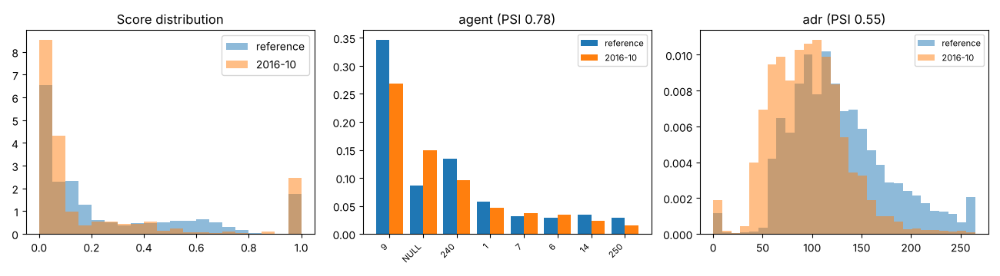

# Drift report: 2016-10

Model `lightgbm-7c2ae42a-c6943bc`. Reference: validation period, Jul to Sep 2016 (15006 bookings). This period: 6196 bookings.

Generated by `scripts/monitor.py`.

## Performance (labels arrived)

| Metric | Reference | This period |
|---|---|---|
| ROC AUC | 0.878 | 0.899 (95% CI 0.891 to 0.906) |
| PR AUC | 0.828 | 0.873 |
| Brier | 0.142 | 0.186 |
| Cancellation rate | 0.356 | 0.406 |

## Prediction drift

Score PSI 0.350 (major). KS statistic 0.202, p 1.4e-157. Mean score 0.267 in the reference, 0.221 now.

## Feature drift

4 of 22 features have PSI >= 0.1. 16 of 22 fail the KS or chi-square test at 0.05 with a Bonferroni correction.

| Feature | Type | PSI | PSI flag | Test | Statistic | p-value | Test flag |
|---|---|---|---|---|---|---|---|
| agent | categorical | 0.781 | major | chi2 | 2546.365 | <1e-300 | yes |
| adr | numeric | 0.551 | major | ks | 0.285 | 1.1e-315 | yes |
| market_segment | categorical | 0.106 | moderate | chi2 | 491.088 | 7.0e-103 | yes |
| stays_in_week_nights | numeric | 0.105 | moderate | ks | 0.115 | 9.6e-51 | yes |
| country | categorical | 0.100 | none | chi2 | 357.497 | 4.9e-48 | yes |
| lead_time | numeric | 0.091 | none | ks | 0.071 | 1.2e-19 | yes |
| distribution_channel | categorical | 0.090 | none | chi2 | 450.900 | 2.1e-97 | yes |
| company | categorical | 0.082 | none | chi2 | 281.279 | 4.3e-51 | yes |
| adults | numeric | 0.081 | none | ks | 0.088 | 9.5e-30 | yes |
| customer_type | categorical | 0.074 | none | chi2 | 322.259 | 1.5e-69 | yes |
| stays_in_weekend_nights | numeric | 0.050 | none | ks | 0.035 | 4.7e-05 | yes |
| children | numeric | 0.045 | none | ks | 0.059 | 9.8e-14 | yes |
| reserved_room_type | categorical | 0.045 | none | chi2 | 166.312 | 1.5e-32 | yes |
| total_of_special_requests | numeric | 0.032 | none | ks | 0.081 | 1.9e-25 | yes |
| meal | categorical | 0.030 | none | chi2 | 90.538 | 1.0e-18 | yes |
| deposit_type | categorical | 0.019 | none | chi2 | 91.025 | 1.7e-20 | yes |
| babies | numeric | 0.008 | none | ks | 0.008 | 0.938 | no |
| is_repeated_guest | numeric | 0.007 | none | ks | 0.011 | 0.616 | no |
| previous_bookings_not_canceled | numeric | 0.004 | none | ks | 0.009 | 0.868 | no |
| days_in_waiting_list | numeric | 0.002 | none | ks | 0.015 | 0.270 | no |
| hotel | categorical | 0.001 | none | chi2 | 2.205 | 0.138 | no |
| previous_cancellations | numeric | 0.000 | none | ks | 0.001 | 1.000 | no |

