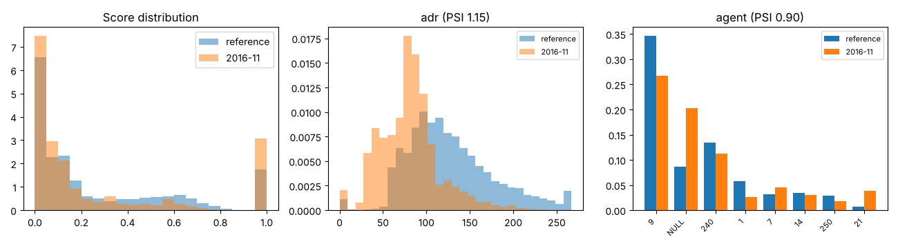

# Drift report: 2016-11

Model `lightgbm-7c2ae42a-c6943bc`. Reference: validation period, Jul to Sep 2016 (15006 bookings). This period: 4434 bookings.

Generated by `scripts/monitor.py`.

## Performance (labels arrived)

| Metric | Reference | This period |
|---|---|---|
| ROC AUC | 0.878 | 0.905 (95% CI 0.897 to 0.914) |
| PR AUC | 0.828 | 0.874 |
| Brier | 0.142 | 0.135 |
| Cancellation rate | 0.356 | 0.369 |

## Prediction drift

Score PSI 0.121 (moderate). KS statistic 0.083, p 6.2e-21. Mean score 0.267 in the reference, 0.266 now.

## Feature drift

8 of 22 features have PSI >= 0.1. 15 of 22 fail the KS or chi-square test at 0.05 with a Bonferroni correction.

| Feature | Type | PSI | PSI flag | Test | Statistic | p-value | Test flag |
|---|---|---|---|---|---|---|---|
| adr | numeric | 1.148 | major | ks | 0.466 | <1e-300 | yes |
| agent | categorical | 0.901 | major | chi2 | 2516.467 | <1e-300 | yes |
| lead_time | numeric | 0.404 | major | ks | 0.280 | 1.2e-237 | yes |
| adults | numeric | 0.236 | major | ks | 0.152 | 1.5e-69 | yes |
| reserved_room_type | categorical | 0.171 | moderate | chi2 | 492.315 | 3.6e-102 | yes |
| country | categorical | 0.169 | moderate | chi2 | 510.126 | 1.7e-74 | yes |
| company | categorical | 0.152 | moderate | chi2 | 508.767 | 7.9e-99 | yes |
| children | numeric | 0.110 | moderate | ks | 0.083 | 6.7e-21 | yes |
| customer_type | categorical | 0.099 | none | chi2 | 206.357 | 1.8e-44 | yes |
| stays_in_week_nights | numeric | 0.092 | none | ks | 0.111 | 5.0e-37 | yes |
| days_in_waiting_list | numeric | 0.087 | none | ks | 0.030 | 0.005 | no |
| stays_in_weekend_nights | numeric | 0.076 | none | ks | 0.113 | 3.0e-38 | yes |
| market_segment | categorical | 0.075 | none | chi2 | 288.938 | 1.9e-59 | yes |
| meal | categorical | 0.073 | none | chi2 | 191.035 | 3.2e-40 | yes |
| distribution_channel | categorical | 0.064 | none | chi2 | 269.453 | 4.1e-58 | yes |
| deposit_type | categorical | 0.043 | none | chi2 | 167.312 | 4.7e-37 | yes |
| is_repeated_guest | numeric | 0.033 | none | ks | 0.029 | 0.006 | no |
| previous_bookings_not_canceled | numeric | 0.022 | none | ks | 0.025 | 0.029 | no |
| total_of_special_requests | numeric | 0.009 | none | ks | 0.021 | 0.100 | no |
| babies | numeric | 0.007 | none | ks | 0.008 | 0.987 | no |
| previous_cancellations | numeric | 0.001 | none | ks | 0.004 | 1.000 | no |
| hotel | categorical | 0.000 | none | chi2 | 1.490 | 0.222 | no |

