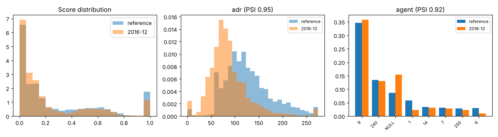

# Drift report: 2016-12

Model `lightgbm-7c2ae42a-c6943bc`. Reference: validation period, Jul to Sep 2016 (15006 bookings). This period: 3846 bookings.

Generated by `scripts/monitor.py`.

## Performance (labels arrived)

| Metric | Reference | This period |
|---|---|---|
| ROC AUC | 0.878 | 0.854 (95% CI 0.842 to 0.866) |
| PR AUC | 0.828 | 0.790 |
| Brier | 0.142 | 0.174 |
| Cancellation rate | 0.356 | 0.363 |

## Prediction drift

Score PSI 0.035 (none). KS statistic 0.085, p 1.5e-19. Mean score 0.267 in the reference, 0.221 now.

## Feature drift

4 of 22 features have PSI >= 0.1. 17 of 22 fail the KS or chi-square test at 0.05 with a Bonferroni correction.

| Feature | Type | PSI | PSI flag | Test | Statistic | p-value | Test flag |
|---|---|---|---|---|---|---|---|
| adr | numeric | 0.946 | major | ks | 0.444 | <1e-300 | yes |
| agent | categorical | 0.915 | major | chi2 | 2056.431 | <1e-300 | yes |
| lead_time | numeric | 0.345 | major | ks | 0.263 | 1.2e-186 | yes |
| country | categorical | 0.274 | major | chi2 | 733.979 | 3.8e-121 | yes |
| meal | categorical | 0.093 | none | chi2 | 369.027 | 1.4e-78 | yes |
| customer_type | categorical | 0.091 | none | chi2 | 104.025 | 2.1e-22 | yes |
| company | categorical | 0.090 | none | chi2 | 193.203 | 3.4e-34 | yes |
| adults | numeric | 0.056 | none | ks | 0.079 | 4.1e-17 | yes |
| market_segment | categorical | 0.050 | none | chi2 | 161.906 | 2.3e-32 | yes |
| is_repeated_guest | numeric | 0.046 | none | ks | 0.036 | 7.5e-04 | yes |
| stays_in_week_nights | numeric | 0.042 | none | ks | 0.072 | 3.8e-14 | yes |
| previous_bookings_not_canceled | numeric | 0.038 | none | ks | 0.035 | 0.001 | yes |
| reserved_room_type | categorical | 0.030 | none | chi2 | 82.902 | 3.5e-15 | yes |
| stays_in_weekend_nights | numeric | 0.027 | none | ks | 0.063 | 7.1e-11 | yes |
| days_in_waiting_list | numeric | 0.014 | none | ks | 0.019 | 0.225 | no |
| distribution_channel | categorical | 0.013 | none | chi2 | 42.348 | 3.4e-09 | yes |
| deposit_type | categorical | 0.011 | none | chi2 | 31.508 | 1.4e-07 | yes |
| hotel | categorical | 0.011 | none | chi2 | 34.153 | 5.1e-09 | yes |
| total_of_special_requests | numeric | 0.007 | none | ks | 0.031 | 0.006 | no |
| children | numeric | 0.005 | none | ks | 0.020 | 0.163 | no |
| babies | numeric | 0.002 | none | ks | 0.005 | 1.000 | no |
| previous_cancellations | numeric | 0.002 | none | ks | 0.005 | 1.000 | no |

