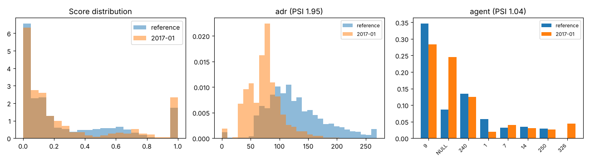

# Drift report: 2017-01

Model `lightgbm-7c2ae42a-c6943bc`. Reference: validation period, Jul to Sep 2016 (15006 bookings). This period: 3673 bookings.

Generated by `scripts/monitor.py`.

## Performance (labels arrived)

| Metric | Reference | This period |
|---|---|---|
| ROC AUC | 0.878 | 0.887 (95% CI 0.876 to 0.898) |
| PR AUC | 0.828 | 0.837 |
| Brier | 0.142 | 0.132 |
| Cancellation rate | 0.356 | 0.340 |

## Prediction drift

Score PSI 0.152 (moderate). KS statistic 0.062, p 2.7e-10. Mean score 0.267 in the reference, 0.270 now.

## Feature drift

10 of 22 features have PSI >= 0.1. 19 of 22 fail the KS or chi-square test at 0.05 with a Bonferroni correction.

| Feature | Type | PSI | PSI flag | Test | Statistic | p-value | Test flag |
|---|---|---|---|---|---|---|---|
| adr | numeric | 1.950 | major | ks | 0.565 | <1e-300 | yes |
| agent | categorical | 1.041 | major | chi2 | 2394.645 | <1e-300 | yes |
| lead_time | numeric | 1.038 | major | ks | 0.438 | <1e-300 | yes |
| company | categorical | 0.326 | major | chi2 | 918.750 | 1.1e-182 | yes |
| country | categorical | 0.288 | major | chi2 | 789.912 | 6.6e-132 | yes |
| market_segment | categorical | 0.284 | major | chi2 | 824.457 | 8.0e-175 | yes |
| adults | numeric | 0.277 | major | ks | 0.204 | 1.8e-108 | yes |
| meal | categorical | 0.125 | moderate | chi2 | 417.311 | 5.1e-89 | yes |
| stays_in_week_nights | numeric | 0.112 | moderate | ks | 0.126 | 3.2e-41 | yes |
| reserved_room_type | categorical | 0.104 | moderate | chi2 | 264.494 | 2.3e-53 | yes |
| distribution_channel | categorical | 0.093 | none | chi2 | 333.274 | 6.2e-72 | yes |
| is_repeated_guest | numeric | 0.078 | none | ks | 0.050 | 5.7e-07 | yes |
| customer_type | categorical | 0.071 | none | chi2 | 112.753 | 2.8e-24 | yes |
| stays_in_weekend_nights | numeric | 0.069 | none | ks | 0.114 | 5.5e-34 | yes |
| previous_bookings_not_canceled | numeric | 0.067 | none | ks | 0.050 | 9.5e-07 | yes |
| days_in_waiting_list | numeric | 0.054 | none | ks | 0.028 | 0.022 | no |
| children | numeric | 0.033 | none | ks | 0.052 | 2.5e-07 | yes |
| total_of_special_requests | numeric | 0.011 | none | ks | 0.045 | 1.2e-05 | yes |
| hotel | categorical | 0.010 | none | chi2 | 28.786 | 8.1e-08 | yes |
| deposit_type | categorical | 0.009 | none | chi2 | 30.130 | 2.9e-07 | yes |
| babies | numeric | 0.004 | none | ks | 0.006 | 1.000 | no |
| previous_cancellations | numeric | 0.000 | none | ks | 0.002 | 1.000 | no |

