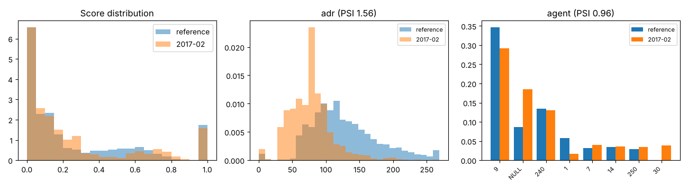

# Drift report: 2017-02

Model `lightgbm-7c2ae42a-c6943bc`. Reference: validation period, Jul to Sep 2016 (15006 bookings). This period: 4168 bookings.

Generated by `scripts/monitor.py`.

## Performance (labels arrived)

| Metric | Reference | This period |
|---|---|---|
| ROC AUC | 0.878 | 0.860 (95% CI 0.850 to 0.871) |
| PR AUC | 0.828 | 0.779 |
| Brier | 0.142 | 0.148 |
| Cancellation rate | 0.356 | 0.326 |

## Prediction drift

Score PSI 0.133 (moderate). KS statistic 0.075, p 1.4e-16. Mean score 0.267 in the reference, 0.252 now.

## Feature drift

8 of 22 features have PSI >= 0.1. 17 of 22 fail the KS or chi-square test at 0.05 with a Bonferroni correction.

| Feature | Type | PSI | PSI flag | Test | Statistic | p-value | Test flag |
|---|---|---|---|---|---|---|---|
| adr | numeric | 1.563 | major | ks | 0.520 | <1e-300 | yes |
| agent | categorical | 0.956 | major | chi2 | 2409.824 | <1e-300 | yes |
| lead_time | numeric | 0.847 | major | ks | 0.401 | <1e-300 | yes |
| company | categorical | 0.300 | major | chi2 | 894.441 | 2.4e-178 | yes |
| country | categorical | 0.158 | moderate | chi2 | 418.376 | 1.3e-59 | yes |
| market_segment | categorical | 0.154 | moderate | chi2 | 501.888 | 3.3e-105 | yes |
| adults | numeric | 0.113 | moderate | ks | 0.119 | 4.9e-41 | yes |
| stays_in_week_nights | numeric | 0.106 | moderate | ks | 0.104 | 3.8e-31 | yes |
| meal | categorical | 0.054 | none | chi2 | 187.148 | 2.2e-39 | yes |
| reserved_room_type | categorical | 0.050 | none | chi2 | 138.132 | 1.3e-26 | yes |
| days_in_waiting_list | numeric | 0.047 | none | ks | 0.027 | 0.016 | no |
| is_repeated_guest | numeric | 0.042 | none | ks | 0.034 | 9.9e-04 | yes |
| distribution_channel | categorical | 0.040 | none | chi2 | 148.666 | 5.1e-32 | yes |
| stays_in_weekend_nights | numeric | 0.037 | none | ks | 0.068 | 1.0e-13 | yes |
| previous_bookings_not_canceled | numeric | 0.034 | none | ks | 0.032 | 0.002 | no |
| customer_type | categorical | 0.025 | none | chi2 | 73.044 | 9.5e-16 | yes |
| hotel | categorical | 0.022 | none | chi2 | 72.834 | 1.4e-17 | yes |
| children | numeric | 0.015 | none | ks | 0.036 | 5.0e-04 | yes |
| total_of_special_requests | numeric | 0.013 | none | ks | 0.042 | 2.1e-05 | yes |
| previous_cancellations | numeric | 0.003 | none | ks | 0.006 | 1.000 | no |
| babies | numeric | 0.003 | none | ks | 0.005 | 1.000 | no |
| deposit_type | categorical | 0.001 | none | chi2 | 3.678 | 0.159 | no |

