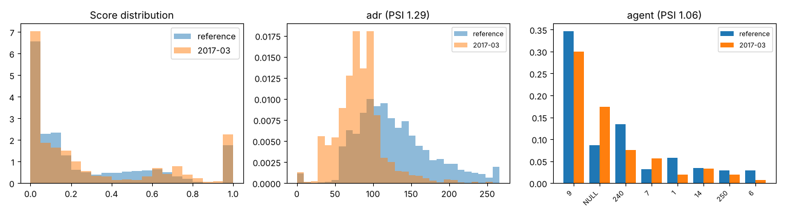

# Drift report: 2017-03

Model `lightgbm-7c2ae42a-c6943bc`. Reference: validation period, Jul to Sep 2016 (15006 bookings). This period: 4948 bookings.

Generated by `scripts/monitor.py`.

## Performance (labels arrived)

| Metric | Reference | This period |
|---|---|---|
| ROC AUC | 0.878 | 0.899 (95% CI 0.890 to 0.908) |
| PR AUC | 0.828 | 0.842 |
| Brier | 0.142 | 0.124 |
| Cancellation rate | 0.356 | 0.338 |

## Prediction drift

Score PSI 0.125 (moderate). KS statistic 0.079, p 2.0e-20. Mean score 0.267 in the reference, 0.296 now.

## Feature drift

8 of 22 features have PSI >= 0.1. 17 of 22 fail the KS or chi-square test at 0.05 with a Bonferroni correction.

| Feature | Type | PSI | PSI flag | Test | Statistic | p-value | Test flag |
|---|---|---|---|---|---|---|---|
| adr | numeric | 1.294 | major | ks | 0.480 | <1e-300 | yes |
| agent | categorical | 1.062 | major | chi2 | 3133.164 | <1e-300 | yes |
| lead_time | numeric | 0.374 | major | ks | 0.279 | 3.6e-257 | yes |
| market_segment | categorical | 0.168 | moderate | chi2 | 698.455 | 1.3e-147 | yes |
| adults | numeric | 0.147 | moderate | ks | 0.125 | 3.8e-51 | yes |
| country | categorical | 0.132 | moderate | chi2 | 405.673 | 3.5e-57 | yes |
| company | categorical | 0.116 | moderate | chi2 | 409.344 | 2.1e-76 | yes |
| children | numeric | 0.108 | moderate | ks | 0.082 | 2.6e-22 | yes |
| meal | categorical | 0.062 | none | chi2 | 225.857 | 1.0e-47 | yes |
| reserved_room_type | categorical | 0.061 | none | chi2 | 169.501 | 3.2e-33 | yes |
| stays_in_week_nights | numeric | 0.055 | none | ks | 0.071 | 7.0e-17 | yes |
| distribution_channel | categorical | 0.052 | none | chi2 | 228.637 | 2.7e-49 | yes |
| is_repeated_guest | numeric | 0.035 | none | ks | 0.030 | 0.002 | yes |
| customer_type | categorical | 0.033 | none | chi2 | 97.914 | 4.4e-21 | yes |
| days_in_waiting_list | numeric | 0.032 | none | ks | 0.024 | 0.023 | no |
| stays_in_weekend_nights | numeric | 0.030 | none | ks | 0.076 | 5.4e-19 | yes |
| previous_bookings_not_canceled | numeric | 0.028 | none | ks | 0.029 | 0.004 | no |
| total_of_special_requests | numeric | 0.022 | none | ks | 0.072 | 4.6e-17 | yes |
| babies | numeric | 0.009 | none | ks | 0.008 | 0.953 | no |
| deposit_type | categorical | 0.008 | none | chi2 | 33.224 | 6.1e-08 | yes |
| previous_cancellations | numeric | 0.004 | none | ks | 0.006 | 0.998 | no |
| hotel | categorical | 0.000 | none | chi2 | 0.345 | 0.557 | no |

