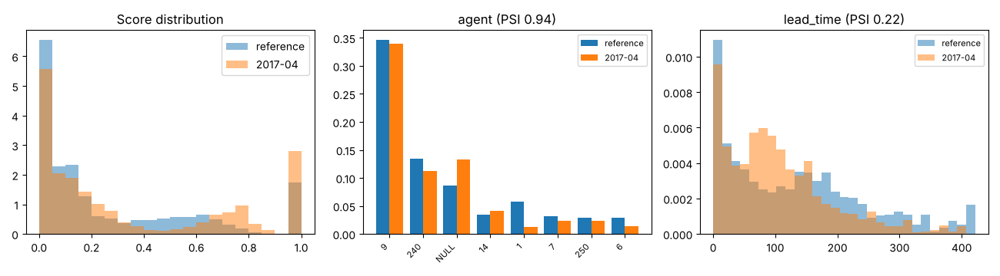

# Drift report: 2017-04

Model `lightgbm-7c2ae42a-c6943bc`. Reference: validation period, Jul to Sep 2016 (15006 bookings). This period: 5653 bookings.

Generated by `scripts/monitor.py`.

## Performance (labels arrived)

| Metric | Reference | This period |
|---|---|---|
| ROC AUC | 0.878 | 0.883 (95% CI 0.876 to 0.891) |
| PR AUC | 0.828 | 0.865 |
| Brier | 0.142 | 0.154 |
| Cancellation rate | 0.356 | 0.435 |

## Prediction drift

Score PSI 0.189 (moderate). KS statistic 0.143, p 1.3e-73. Mean score 0.267 in the reference, 0.343 now.

## Feature drift

4 of 22 features have PSI >= 0.1. 15 of 22 fail the KS or chi-square test at 0.05 with a Bonferroni correction.

| Feature | Type | PSI | PSI flag | Test | Statistic | p-value | Test flag |
|---|---|---|---|---|---|---|---|
| agent | categorical | 0.939 | major | chi2 | 2822.534 | <1e-300 | yes |
| lead_time | numeric | 0.219 | major | ks | 0.173 | 1.7e-108 | yes |
| adr | numeric | 0.185 | moderate | ks | 0.174 | 4.0e-109 | yes |
| company | categorical | 0.144 | moderate | chi2 | 484.834 | 1.6e-91 | yes |
| stays_in_week_nights | numeric | 0.083 | none | ks | 0.062 | 4.2e-14 | yes |
| market_segment | categorical | 0.081 | none | chi2 | 359.976 | 1.1e-74 | yes |
| country | categorical | 0.079 | none | chi2 | 285.478 | 3.2e-33 | yes |
| stays_in_weekend_nights | numeric | 0.071 | none | ks | 0.036 | 4.6e-05 | yes |
| deposit_type | categorical | 0.031 | none | chi2 | 136.872 | 1.9e-30 | yes |
| days_in_waiting_list | numeric | 0.029 | none | ks | 0.024 | 0.021 | no |
| meal | categorical | 0.026 | none | chi2 | 116.130 | 3.6e-24 | yes |
| reserved_room_type | categorical | 0.023 | none | chi2 | 87.586 | 3.9e-16 | yes |
| total_of_special_requests | numeric | 0.020 | none | ks | 0.050 | 2.6e-09 | yes |
| adults | numeric | 0.019 | none | ks | 0.036 | 3.6e-05 | yes |
| children | numeric | 0.014 | none | ks | 0.034 | 1.2e-04 | yes |
| previous_cancellations | numeric | 0.010 | none | ks | 0.009 | 0.903 | no |
| babies | numeric | 0.007 | none | ks | 0.008 | 0.965 | no |
| distribution_channel | categorical | 0.004 | none | chi2 | 18.116 | 4.2e-04 | yes |
| is_repeated_guest | numeric | 0.003 | none | ks | 0.007 | 0.979 | no |
| previous_bookings_not_canceled | numeric | 0.002 | none | ks | 0.007 | 0.987 | no |
| customer_type | categorical | 0.002 | none | chi2 | 8.845 | 0.031 | no |
| hotel | categorical | 0.000 | none | chi2 | 0.053 | 0.819 | no |

