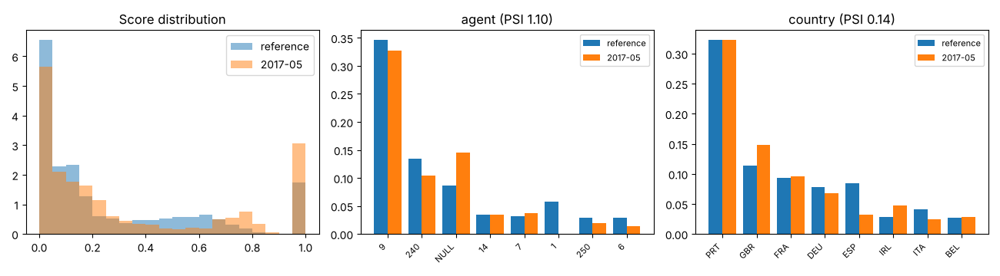

# Drift report: 2017-05

Model `lightgbm-7c2ae42a-c6943bc`. Reference: validation period, Jul to Sep 2016 (15006 bookings). This period: 6305 bookings.

Generated by `scripts/monitor.py`.

## Performance (labels arrived)

| Metric | Reference | This period |
|---|---|---|
| ROC AUC | 0.878 | 0.882 (95% CI 0.874 to 0.891) |
| PR AUC | 0.828 | 0.868 |
| Brier | 0.142 | 0.158 |
| Cancellation rate | 0.356 | 0.438 |

## Prediction drift

Score PSI 0.164 (moderate). KS statistic 0.128, p 1.3e-63. Mean score 0.267 in the reference, 0.336 now.

## Feature drift

4 of 22 features have PSI >= 0.1. 17 of 22 fail the KS or chi-square test at 0.05 with a Bonferroni correction.

| Feature | Type | PSI | PSI flag | Test | Statistic | p-value | Test flag |
|---|---|---|---|---|---|---|---|
| agent | categorical | 1.101 | major | chi2 | 2733.200 | <1e-300 | yes |
| country | categorical | 0.144 | moderate | chi2 | 511.342 | 1.0e-76 | yes |
| adr | numeric | 0.106 | moderate | ks | 0.084 | 6.8e-28 | yes |
| market_segment | categorical | 0.104 | moderate | chi2 | 500.011 | 8.4e-105 | yes |
| adults | numeric | 0.098 | none | ks | 0.091 | 1.3e-32 | yes |
| company | categorical | 0.090 | none | chi2 | 298.709 | 2.1e-53 | yes |
| lead_time | numeric | 0.080 | none | ks | 0.079 | 2.4e-24 | yes |
| children | numeric | 0.074 | none | ks | 0.071 | 6.6e-20 | yes |
| deposit_type | categorical | 0.045 | none | chi2 | 216.780 | 8.5e-48 | yes |
| stays_in_week_nights | numeric | 0.044 | none | ks | 0.079 | 2.9e-24 | yes |
| reserved_room_type | categorical | 0.039 | none | chi2 | 134.616 | 6.8e-26 | yes |
| days_in_waiting_list | numeric | 0.037 | none | ks | 0.025 | 0.008 | no |
| meal | categorical | 0.030 | none | chi2 | 124.806 | 5.0e-26 | yes |
| stays_in_weekend_nights | numeric | 0.028 | none | ks | 0.049 | 9.5e-10 | yes |
| is_repeated_guest | numeric | 0.014 | none | ks | 0.017 | 0.133 | no |
| distribution_channel | categorical | 0.012 | none | chi2 | 54.621 | 8.3e-12 | yes |
| customer_type | categorical | 0.008 | none | chi2 | 34.963 | 1.2e-07 | yes |
| previous_bookings_not_canceled | numeric | 0.007 | none | ks | 0.013 | 0.443 | no |
| previous_cancellations | numeric | 0.006 | none | ks | 0.008 | 0.960 | no |
| hotel | categorical | 0.005 | none | chi2 | 20.479 | 6.0e-06 | yes |
| babies | numeric | 0.005 | none | ks | 0.007 | 0.991 | no |
| total_of_special_requests | numeric | 0.004 | none | ks | 0.029 | 0.001 | yes |

