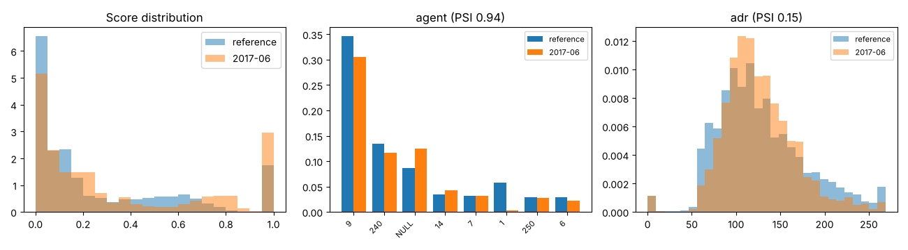

# Drift report: 2017-06

Model `lightgbm-7c2ae42a-c6943bc`. Reference: validation period, Jul to Sep 2016 (15006 bookings). This period: 5639 bookings.

Generated by `scripts/monitor.py`.

## Performance (labels arrived)

| Metric | Reference | This period |
|---|---|---|
| ROC AUC | 0.878 | 0.862 (95% CI 0.852 to 0.871) |
| PR AUC | 0.828 | 0.844 |
| Brier | 0.142 | 0.165 |
| Cancellation rate | 0.356 | 0.432 |

## Prediction drift

Score PSI 0.201 (major). KS statistic 0.133, p 3.1e-63. Mean score 0.267 in the reference, 0.346 now.

## Feature drift

4 of 22 features have PSI >= 0.1. 15 of 22 fail the KS or chi-square test at 0.05 with a Bonferroni correction.

| Feature | Type | PSI | PSI flag | Test | Statistic | p-value | Test flag |
|---|---|---|---|---|---|---|---|
| agent | categorical | 0.942 | major | chi2 | 2515.038 | <1e-300 | yes |
| adr | numeric | 0.151 | moderate | ks | 0.092 | 7.7e-31 | yes |
| country | categorical | 0.133 | moderate | chi2 | 440.307 | 2.2e-63 | yes |
| company | categorical | 0.109 | moderate | chi2 | 324.642 | 8.4e-61 | yes |
| lead_time | numeric | 0.048 | none | ks | 0.052 | 4.5e-10 | yes |
| days_in_waiting_list | numeric | 0.048 | none | ks | 0.026 | 0.008 | no |
| reserved_room_type | categorical | 0.038 | none | chi2 | 114.079 | 1.3e-21 | yes |
| deposit_type | categorical | 0.037 | none | chi2 | 166.563 | 6.8e-37 | yes |
| adults | numeric | 0.031 | none | ks | 0.039 | 5.5e-06 | yes |
| stays_in_week_nights | numeric | 0.029 | none | ks | 0.036 | 5.1e-05 | yes |
| customer_type | categorical | 0.026 | none | chi2 | 104.982 | 1.3e-22 | yes |
| market_segment | categorical | 0.025 | none | chi2 | 112.217 | 7.0e-22 | yes |
| children | numeric | 0.021 | none | ks | 0.041 | 1.7e-06 | yes |
| meal | categorical | 0.021 | none | chi2 | 82.730 | 4.6e-17 | yes |
| is_repeated_guest | numeric | 0.011 | none | ks | 0.015 | 0.310 | no |
| stays_in_weekend_nights | numeric | 0.010 | none | ks | 0.031 | 6.1e-04 | yes |
| babies | numeric | 0.007 | none | ks | 0.008 | 0.966 | no |
| previous_bookings_not_canceled | numeric | 0.007 | none | ks | 0.013 | 0.532 | no |
| distribution_channel | categorical | 0.005 | none | chi2 | 23.992 | 2.5e-05 | yes |
| total_of_special_requests | numeric | 0.003 | none | ks | 0.018 | 0.149 | no |
| previous_cancellations | numeric | 0.003 | none | ks | 0.005 | 1.000 | no |
| hotel | categorical | 0.001 | none | chi2 | 3.146 | 0.076 | no |

