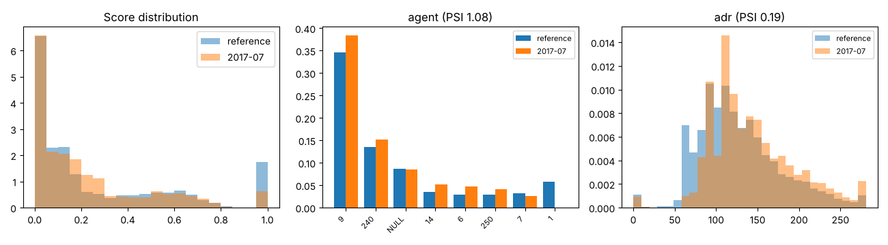

# Drift report: 2017-07

Model `lightgbm-7c2ae42a-c6943bc`. Reference: validation period, Jul to Sep 2016 (15006 bookings). This period: 5310 bookings.

Generated by `scripts/monitor.py`.

## Performance (labels arrived)

| Metric | Reference | This period |
|---|---|---|
| ROC AUC | 0.878 | 0.782 (95% CI 0.772 to 0.795) |
| PR AUC | 0.828 | 0.673 |
| Brier | 0.142 | 0.214 |
| Cancellation rate | 0.356 | 0.374 |

## Prediction drift

Score PSI 0.111 (moderate). KS statistic 0.076, p 3.6e-20. Mean score 0.267 in the reference, 0.220 now.

## Feature drift

3 of 22 features have PSI >= 0.1. 16 of 22 fail the KS or chi-square test at 0.05 with a Bonferroni correction.

| Feature | Type | PSI | PSI flag | Test | Statistic | p-value | Test flag |
|---|---|---|---|---|---|---|---|
| agent | categorical | 1.075 | major | chi2 | 1931.289 | <1e-300 | yes |
| adr | numeric | 0.186 | moderate | ks | 0.161 | 2.9e-89 | yes |
| country | categorical | 0.153 | moderate | chi2 | 542.926 | 5.8e-84 | yes |
| days_in_waiting_list | numeric | 0.093 | none | ks | 0.029 | 0.002 | yes |
| market_segment | categorical | 0.073 | none | chi2 | 256.840 | 1.4e-52 | yes |
| deposit_type | categorical | 0.062 | none | chi2 | 189.333 | 7.7e-42 | yes |
| lead_time | numeric | 0.057 | none | ks | 0.098 | 5.9e-33 | yes |
| company | categorical | 0.043 | none | chi2 | 53.541 | 1.4e-07 | yes |
| total_of_special_requests | numeric | 0.037 | none | ks | 0.092 | 1.7e-29 | yes |
| meal | categorical | 0.033 | none | chi2 | 138.088 | 7.2e-29 | yes |
| reserved_room_type | categorical | 0.025 | none | chi2 | 101.951 | 4.3e-19 | yes |
| stays_in_weekend_nights | numeric | 0.019 | none | ks | 0.062 | 1.6e-13 | yes |
| stays_in_week_nights | numeric | 0.018 | none | ks | 0.031 | 0.001 | yes |
| customer_type | categorical | 0.011 | none | chi2 | 40.452 | 8.5e-09 | yes |
| children | numeric | 0.008 | none | ks | 0.031 | 0.001 | yes |
| distribution_channel | categorical | 0.005 | none | chi2 | 19.673 | 2.0e-04 | yes |
| previous_cancellations | numeric | 0.005 | none | ks | 0.007 | 0.994 | no |
| babies | numeric | 0.004 | none | ks | 0.006 | 0.999 | no |
| adults | numeric | 0.003 | none | ks | 0.013 | 0.530 | no |
| is_repeated_guest | numeric | 0.002 | none | ks | 0.006 | 0.997 | no |
| hotel | categorical | 0.002 | none | chi2 | 7.645 | 0.006 | no |
| previous_bookings_not_canceled | numeric | 0.001 | none | ks | 0.004 | 1.000 | no |

