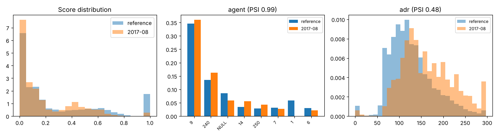

# Drift report: 2017-08

Model `lightgbm-7c2ae42a-c6943bc`. Reference: validation period, Jul to Sep 2016 (15006 bookings). This period: 4923 bookings.

Generated by `scripts/monitor.py`.

## Performance (labels arrived)

| Metric | Reference | This period |
|---|---|---|
| ROC AUC | 0.878 | 0.760 (95% CI 0.747 to 0.772) |
| PR AUC | 0.828 | 0.650 |
| Brier | 0.142 | 0.226 |
| Cancellation rate | 0.356 | 0.368 |

## Prediction drift

Score PSI 0.210 (major). KS statistic 0.122, p 2.7e-48. Mean score 0.267 in the reference, 0.188 now.

## Feature drift

5 of 22 features have PSI >= 0.1. 17 of 22 fail the KS or chi-square test at 0.05 with a Bonferroni correction.

| Feature | Type | PSI | PSI flag | Test | Statistic | p-value | Test flag |
|---|---|---|---|---|---|---|---|
| agent | categorical | 0.985 | major | chi2 | 1922.749 | <1e-300 | yes |
| adr | numeric | 0.475 | major | ks | 0.277 | 1.7e-252 | yes |
| days_in_waiting_list | numeric | 0.176 | moderate | ks | 0.031 | 0.002 | yes |
| deposit_type | categorical | 0.136 | moderate | chi2 | 302.909 | 1.7e-66 | yes |
| total_of_special_requests | numeric | 0.103 | moderate | ks | 0.139 | 2.6e-63 | yes |
| market_segment | categorical | 0.099 | none | chi2 | 304.098 | 1.1e-62 | yes |
| country | categorical | 0.091 | none | chi2 | 287.722 | 4.0e-35 | yes |
| lead_time | numeric | 0.050 | none | ks | 0.052 | 2.8e-09 | yes |
| meal | categorical | 0.049 | none | chi2 | 192.485 | 1.5e-40 | yes |
| stays_in_week_nights | numeric | 0.046 | none | ks | 0.099 | 3.8e-32 | yes |
| reserved_room_type | categorical | 0.043 | none | chi2 | 159.471 | 4.1e-31 | yes |
| company | categorical | 0.042 | none | chi2 | 62.658 | 3.0e-09 | yes |
| customer_type | categorical | 0.024 | none | chi2 | 93.567 | 3.8e-20 | yes |
| children | numeric | 0.021 | none | ks | 0.050 | 1.7e-08 | yes |
| distribution_channel | categorical | 0.018 | none | chi2 | 54.521 | 8.7e-12 | yes |
| stays_in_weekend_nights | numeric | 0.017 | none | ks | 0.049 | 4.3e-08 | yes |
| hotel | categorical | 0.014 | none | chi2 | 52.771 | 3.7e-13 | yes |
| previous_cancellations | numeric | 0.008 | none | ks | 0.008 | 0.963 | no |
| adults | numeric | 0.006 | none | ks | 0.020 | 0.107 | no |
| is_repeated_guest | numeric | 0.002 | none | ks | 0.006 | 0.999 | no |
| babies | numeric | 0.001 | none | ks | 0.003 | 1.000 | no |
| previous_bookings_not_canceled | numeric | 0.000 | none | ks | 0.001 | 1.000 | no |

