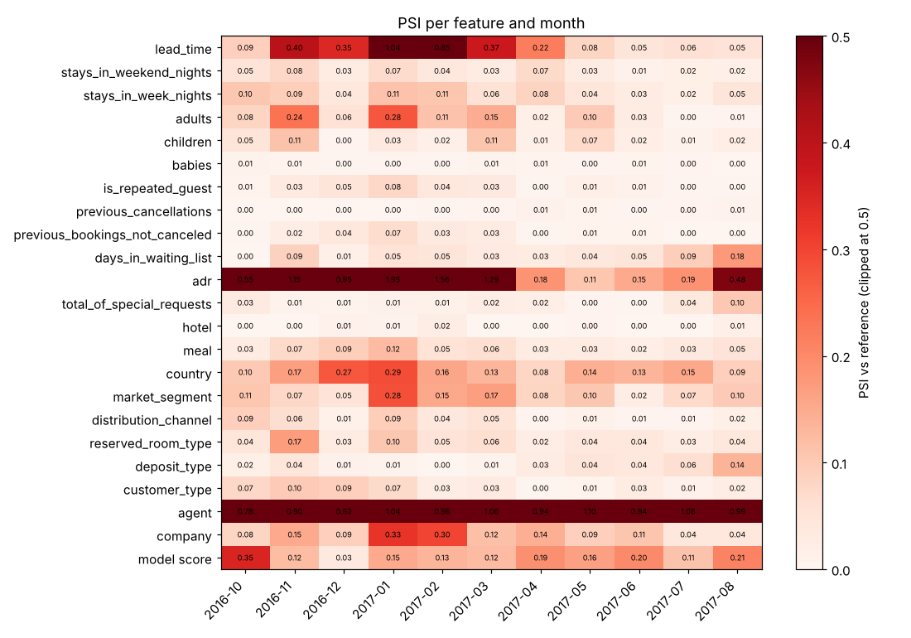
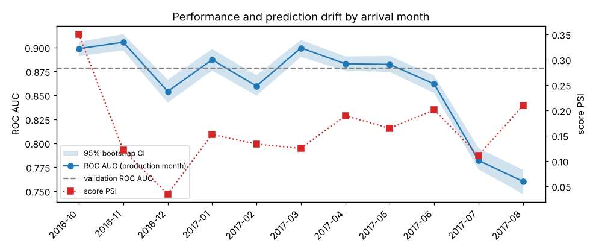

# Drift reports

One report per production month, built by `scripts/monitor.py` from the prediction log that `scripts/replay.py` writes.

| Month | Bookings | ROC AUC | Score PSI | Features with PSI >= 0.1 | Features failing test | Report |
|---|---|---|---|---|---|---|
| 2016-10 | 6196 | 0.899 | 0.350 | 4 / 22 | 16 / 22 | [2016-10](2016-10.md) |
| 2016-11 | 4434 | 0.905 | 0.121 | 8 / 22 | 15 / 22 | [2016-11](2016-11.md) |
| 2016-12 | 3846 | 0.854 | 0.035 | 4 / 22 | 17 / 22 | [2016-12](2016-12.md) |
| 2017-01 | 3673 | 0.887 | 0.152 | 10 / 22 | 19 / 22 | [2017-01](2017-01.md) |
| 2017-02 | 4168 | 0.860 | 0.133 | 8 / 22 | 17 / 22 | [2017-02](2017-02.md) |
| 2017-03 | 4948 | 0.899 | 0.125 | 8 / 22 | 17 / 22 | [2017-03](2017-03.md) |
| 2017-04 | 5653 | 0.883 | 0.189 | 4 / 22 | 15 / 22 | [2017-04](2017-04.md) |
| 2017-05 | 6305 | 0.882 | 0.164 | 4 / 22 | 17 / 22 | [2017-05](2017-05.md) |
| 2017-06 | 5639 | 0.862 | 0.201 | 4 / 22 | 15 / 22 | [2017-06](2017-06.md) |
| 2017-07 | 5310 | 0.782 | 0.111 | 3 / 22 | 16 / 22 | [2017-07](2017-07.md) |
| 2017-08 | 4923 | 0.760 | 0.210 | 5 / 22 | 17 / 22 | [2017-08](2017-08.md) |
